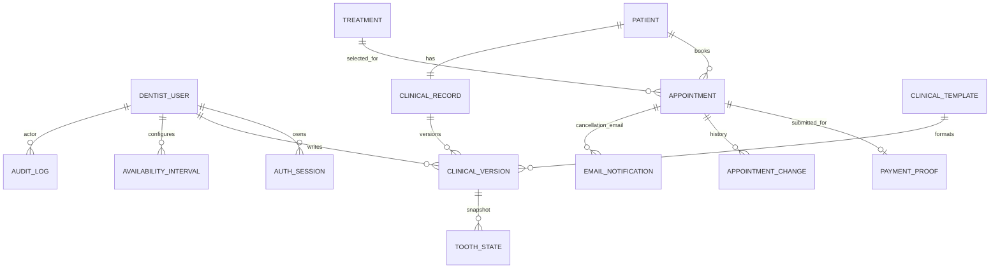

# DATA-MODEL — modelo de datos preliminar

**Estado:** PROPUESTA / no aprobar migraciones antes de validar S-01…S-14 y ADR. **Fuente:** sección 11 de `Doc_Dentista_v4.2.docx` + convenciones del brief. **Motor sugerido:** PostgreSQL (pendiente de ADR); **PK sugerida:** UUID.

## Convenciones

Tablas/columnas en `snake_case` inglés; la UI en español. PK UUID por consistencia (sin requisito de offline); FKs explícitas; `created_at` y `updated_at` UTC cuando proceda; instantes UTC, render `America/La_Paz`; dinero `bigint` en centavos (`*_cents`) más columna `currency` (`'BOB'`, `CHECK currency = 'BOB'` mientras no se apruebe otra moneda) en cada tabla con importes, según ADR-002; sin `float`. Se conservan los 5 estados del documento, sin añadir otros silenciosamente. Identificadores públicos opacos; jamás confiar en ID del cliente para autorizar accesos. No borrado físico de citas, pacientes, versiones ni auditoría.

Los campos `?` son opcionales; `PK`/`FK`/`UNIQUE` indican restricciones propuestas. Los tamaños concretos y la política de retención deben definirse al diseñar migraciones.

## Tablas: propósito, columnas, restricciones, índices y trazabilidad

### `dentist_user` — única cuenta administrativa (RF-13, RF-25, RF-27)

- `id uuid PK`; `username varchar UNIQUE NOT NULL`; `password_hash text NOT NULL`; `full_name varchar NOT NULL`; `active boolean DEFAULT true`; `failed_attempts int DEFAULT 0`; `locked_until timestamptz?`; `created_at timestamptz`; `updated_at timestamptz`.
- Índices: `UNIQUE(lower(username))`; nunca almacenar contraseña plana. Un solo usuario activo es regla de negocio, no un modelo multi-odontólogo implícito.

### `auth_session` — sesión revocable del dentista (RF-13, RNF-05/06)

- `id uuid PK`; `user_id uuid FK dentist_user`; `secret_hash text NOT NULL`; `created_at timestamptz`; `last_activity_at timestamptz`; `expires_at timestamptz`; `revoked_at timestamptz?`.
- Índice `(user_id, expires_at)`; secreto entregado solo en cookie segura. Aplicar inactividad de 30 min y CSRF.

### `patient` — datos de contacto (RF-03/04/08/22/23)

- `id uuid PK`; `full_name varchar NOT NULL`; `normalized_name varchar NOT NULL`; `phone varchar NOT NULL`; `email varchar?`; `origin enum('web','dentist')`; `created_at timestamptz`; `updated_at timestamptz`; `updated_by uuid FK dentist_user?`.
- `UNIQUE(normalized_name, phone)`; índice por `phone`, búsqueda indexada por nombre normalizado. Normalización y formato de celular deben ser deterministas. **El correo es obligatorio durante CU-01, opcional en CU-12**.

### `treatment` — catálogo vigente (RF-01/15)

- `id uuid PK`; `name varchar UNIQUE NOT NULL`; `description text?`; `deposit_cents bigint NOT NULL`; `currency char(3) NOT NULL DEFAULT 'BOB'`; `active boolean DEFAULT true`; `created_at timestamptz`; `updated_at timestamptz`.
- `CHECK deposit_cents BETWEEN 1000 AND 2000` (10–20 Bs). Eliminar es desactivar. Semilla de siete tratamientos exactos del Word.

### `availability_interval` — horario por fecha (RF-02/14)

- `id uuid PK`; `service_date date NOT NULL`; `starts_local time NOT NULL`; `ends_local time NOT NULL`; `created_by uuid FK dentist_user`; `created_at timestamptz`; `updated_at timestamptz`.
- `CHECK ends_local > starts_local`; al menos 90 min; prohibición de intervalos superpuestos por fecha; índice `service_date`. Validar al modificar que no excluya una cita confirmada. Si aparecen intervalos nocturnos, abrir ADR: v4.2 no los requiere.

### `appointment` — agenda y estado de vida (RF-02/04/05/06/16–20/26)

- `id uuid PK`; `patient_id uuid FK patient NOT NULL`; `treatment_id uuid FK treatment NOT NULL`; `starts_at timestamptz NOT NULL`; `ends_at timestamptz NOT NULL`; `status appointment_status NOT NULL`; `deposit_cents bigint NOT NULL` (snapshot); `diagnosis text?`; `cost_cents bigint?`; `currency char(3) NOT NULL DEFAULT 'BOB'` (aplica a `deposit_cents` y `cost_cents`); `refunded enum('yes','no','not_applicable')?`; `cancel_reason text?`; `origin enum('web','dentist')`; `created_at timestamptz`; `updated_at timestamptz`; `completed_at timestamptz?`; `completed_by uuid FK dentist_user?`; `canceled_at timestamptz?`; `canceled_by uuid FK dentist_user?`.
- `ends_at = starts_at + interval '90 minutes'`, costo no negativo, estado terminal inmutable. Indexar `(starts_at,status)` y `(patient_id,starts_at)`. `deposit_cents` **no** se recalcula al cambiar `treatment`.
- **Integridad crítica:** impedir superposición entre citas `confirmada` por restricción transaccional en PostgreSQL (p. ej. índice GiST/exclusion constraint `tstzrange(starts_at,ends_at,'[)')` `WITH &&` `WHERE status='confirmada'` y extensión `btree_gist` si necesaria). El literal del predicado debe coincidir exactamente con el valor almacenado del enum `appointment_status`. Validación UX previa **no sustituye** la restricción de BD. Aclarar si `completada` debe excluirse también: el texto v4.2 especifica solo `confirmada`.
- Contar 3 pendientes por paciente **transaccionalmente** al crear (evitar condición de carrera).

### `payment_proof` — anticipo QR fuera del sistema (RF-07/17/18)

- `id uuid PK`; `appointment_id uuid FK appointment UNIQUE NOT NULL`; `receipt_number varchar UNIQUE NOT NULL`; `amount_cents bigint NOT NULL`; `currency char(3) NOT NULL DEFAULT 'BOB'`; `submitted_at timestamptz NOT NULL`; `confirmed_by uuid FK dentist_user?`; `confirmed_at timestamptz?`; `created_at timestamptz`.
- No se integra con bancos; el dentista verifica y confirma. Rechazo como estado/acción **prohibido** por v4.2. Confirmación y transición de `appointment` ocurren en una transacción.

### `clinical_record` — agregado clínico de paciente (RF-23–25)

- `id uuid PK`; `patient_id uuid FK patient UNIQUE NOT NULL`; `created_at timestamptz`; `created_by uuid FK dentist_user?`.
- Uno por paciente, no borrar. No aparece en respuestas públicas.

### `clinical_template` — formato base versionable (RF-24)

- `id uuid PK`; `name varchar UNIQUE NOT NULL`; `description text?`; `active boolean DEFAULT true`; `created_at timestamptz`; `updated_at timestamptz`.
- Solo plantillas autorizadas, sin incorporar automáticamente tipos clínicos no validados.

### `clinical_version` — foto inmutable de historial (RF-24/25)

- `id uuid PK`; `clinical_record_id uuid FK clinical_record NOT NULL`; `template_id uuid FK clinical_template?`; `version_number int NOT NULL`; `anamnesis jsonb/text NOT NULL`; `dental_index_type varchar?`; `dental_index_value varchar?`; `diagnosis text?`; `created_by uuid FK dentist_user NOT NULL`; `created_at timestamptz NOT NULL`; `content_hash varchar?`.
- `UNIQUE(clinical_record_id,version_number)`; solo INSERT, prohibir UPDATE/DELETE a nivel permisos/trigger según ADR. Guardado «sin cambios» no genera versión; comparar contenido clínico canónico.

### `tooth_state` — odontograma histórico de una versión (RF-24)

- `id uuid PK`; `clinical_version_id uuid FK clinical_version NOT NULL`; `tooth_code varchar NOT NULL`; `state_code varchar NOT NULL`.
- `UNIQUE(clinical_version_id,tooth_code)` **si el estado es por pieza**. Si el dentista confirma estados por superficie, cambiar el diseño antes de migrar. Validar notación FDI y dentición temporal (S-14 y sección 13).

### `appointment_change` — movimientos y estados (RF-19/20/27)

- `id uuid PK`; `appointment_id uuid FK appointment`; `action varchar`; `old_value jsonb?`; `new_value jsonb?`; `performed_by uuid FK dentist_user?`; `performed_at timestamptz`.
- Solo INSERT. Anota reprogramaciones, confirmaciones, cancelaciones y cierre; los eventos automáticos quedan identificados como `system` según política acordada.

### `audit_log` — auditoría transversal (RF-27, RNF-08)

- `id uuid PK`; `actor_user_id uuid FK dentist_user?`; `actor_kind enum('dentist','system')`; `entity_type varchar`; `entity_id uuid`; `action varchar`; `before_json jsonb?`; `after_json jsonb?`; `occurred_at timestamptz`; `ip_hash varchar?`.
- Solo INSERT; preservar confidencialidad: no registrar datos clínicos completos innecesarios ni credenciales. Auditoría de **lectura clínica** es exigencia del brief técnico y debe reflejarse en criterios de QA. Retención mínima de 2 años está **propuesta**, pendiente de validación.

### `email_notification` — outbox/correo de cancelación (RF-21)

- `id uuid PK`; `appointment_id uuid FK appointment`; `recipient_email varchar`; `kind enum('appointment_canceled')`; `delivery_status enum('pending','sent','failed')`; `attempts int DEFAULT 0`; `next_attempt_at timestamptz?`; `last_error_code varchar?`; `sent_at timestamptz?`; `created_at timestamptz`.
- Outbox transaccional con cancelación, worker idempotente, **máximo 3 intentos** (clarificar si el envío inicial cuenta entre los 3). Correo sólo cancelación; ausencia de email informa al dentista y no genera envío.

### `public_lookup_attempt` — protección de CU-03 (RF-09)

- `id uuid PK`; `origin_hash varchar NOT NULL`; `attempted_at timestamptz`; `successful boolean`; `blocked_until timestamptz?`.
- Propuesta de almacenamiento temporal con retención mínima, sin datos identificables en claro; rate limiting distribuido (Redis o BD), según despliegue. Regla: 5 fallos en 10 minutos → 15 minutos de bloqueo.

## Relaciones principales (modelo tentativo)

## Enumeraciones (no ampliar sin validación)

- `appointment_status`: `por_pagar`, `pago_en_revision`, `confirmada`, `completada`, `cancelada` (API puede utilizar strings ingleses si establece mapeo explícito en `packages/contracts`, preservando semántica y trazabilidad).
- `patient_origin`: `web`, `dentist`.
- `refund_status`: `yes`, `no`, `not_applicable`.
- `notification_status`: `pending`, `sent`, `failed`.
- `clinical_tooth_state`: **pendiente del dentista**; nunca inventar un catálogo definitivo.

## Flujos de integridad y seguridad

1. **Confirmación:** transacción verifica estado `pago_en_revision`, comprobante y disponibilidad; cambia a `confirmada`; registra actor/fecha/auditoría. Una segunda confirmación solapada debe fallar inequívocamente, incluso bajo concurrencia.
2. **Reprogramación:** misma transacción, validar intervalo, actualizar inicio y fin, registrar ambos valores y auditoría; estado terminal no modificable.
3. **Cancelación:** cambio a `cancelada` y evento de correo en outbox **atómicos**; enviar en proceso separado. No borrar fila.
4. **Caducidad:** job con marca de idempotencia cancela únicamente `por_pagar` de inicio pasado; no reinterpretar `pago_en_revision` sin aprobación.
5. **Nueva versión clínica:** transacción inserta `clinical_version` n+1 y `tooth_state` asociado, sin actualizar versión previa.
6. **Pacientes:** único por par normalizado+celular; mismo celular con distinto nombre requiere advertencia en UI administrativa; no deduplicar automáticamente familiares.
7. **Control público:** consulta de citas minimiza exposición. La seguridad de nombre+celular solo está definida en v4.2; el riesgo de suplantación queda elevado para decisión S-01.

## Seeds propuestas

- Siete tratamientos: limpieza, blanqueamiento, exodoncia, prótesis fija, prótesis removible, obturación, cirugía de terceros molares. **Anticipos específicos sin valor hasta aprobación del dentista** (rango válido 10–20 Bs).
- Plantilla básica de historia clínica. Catálogo de piezas FDI, índice CPO-D y estados sólo tras validación.
- Primer dentista mediante CLI segura, con contraseña inicial temporal y cambio obligatorio. No subir usuario/secretos reales a Git.

## Orden de migraciones sugerido

1. Usuarios y sesiones.
2. Pacientes y tratamientos.
3. Intervalos y citas + restricción de solapes.
4. Comprobantes y cambios de cita.
5. Historia, plantillas, versiones y estados de piezas.
6. Auditoría/outbox y seguridad de búsquedas públicas.
7. Seeds aprobadas.

Cada migración debe contar con test de integridad; rollback explícito cuando sea seguro. El diseño definitivo requiere respuesta a las preguntas de `VALIDACION-REQUISITOS.md` y aprobación del ADR de motor/PK.
