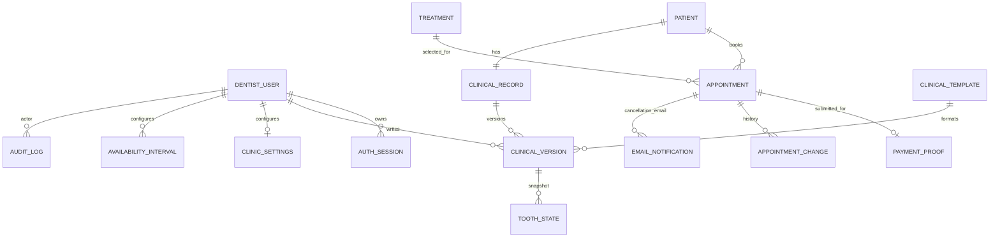

# DATA-MODEL — modelo de datos preliminar

**Estado:** PROPUESTA / no aprobar migraciones hasta cerrar las preguntas abiertas de `VALIDACION-REQUISITOS.md` §7 (en especial la duración de consulta). **Fuente:** sección 11 de `Doc_Dentista_v4.2.docx`, modificada por las respuestas del cliente del 2026-11-20 (V-01…V-13), + convenciones del brief. **Motor:** PostgreSQL (ACEPTADO por el cliente, ADR-001); **PK sugerida:** UUID.

## Convenciones

Tablas/columnas en `snake_case` inglés; la UI en español. PK UUID por consistencia (sin requisito de offline); FKs explícitas; `created_at` y `updated_at` UTC cuando proceda; instantes UTC, render `America/La_Paz`; dinero `bigint` en centavos (`*_cents`) más columna `currency` (`'BOB'`, `CHECK currency = 'BOB'` mientras no se apruebe otra moneda) en cada tabla con importes, según ADR-002; sin `float`. Se usan los 5 estados aprobados por el cliente (V-08, V-22), sin añadir otros silenciosamente. Identificadores públicos opacos; jamás confiar en ID del cliente para autorizar accesos. No borrado físico de citas, pacientes, versiones ni auditoría.

Los campos `?` son opcionales; `PK`/`FK`/`UNIQUE` indican restricciones propuestas. Los tamaños concretos y la política de retención deben definirse al diseñar migraciones.

## Tablas: propósito, columnas, restricciones, índices y trazabilidad

### `dentist_user` — única cuenta administrativa (RF-13, RF-25, RF-27)

- `id uuid PK`; `username varchar(64) NOT NULL`; `password_hash text NOT NULL` (Argon2id); `full_name varchar(120) NOT NULL`; `active boolean DEFAULT true`; `must_change_password boolean DEFAULT true`; `failed_attempts int DEFAULT 0`; `locked_until timestamptz?`; `created_at timestamptz`; `updated_at timestamptz`. **Implementada** en la migración `AuthAndAudit1764200000000` (B-04).
- Índices: `UNIQUE(lower(username))` y `UNIQUE ((true)) WHERE active` (un solo dentista activo, garantizado por la BD); nunca almacenar contraseña plana.

### `auth_session` — sesión revocable del dentista (RF-13, RNF-05/06)

- `id uuid PK`; `user_id uuid FK dentist_user`; `secret_hash char(64) NOT NULL` (SHA-256 del secreto); `created_at timestamptz`; `last_activity_at timestamptz`; `expires_at timestamptz` (máximo 12 h); `revoked_at timestamptz?`. **Implementada** (B-04).
- Índice `(user_id, expires_at)`; secreto entregado solo en cookie segura. Aplicar inactividad de 30 min y CSRF.

### `patient` — datos de contacto (RF-03/04/08/22/23)

- `id uuid PK`; `full_name varchar NOT NULL`; `normalized_name varchar NOT NULL`; `phone varchar NOT NULL`; `email varchar?`; `birth_date date?` (obligatoria al registrarse por la web, V-02); `is_minor boolean DEFAULT false` (etiqueta de menor, V-18); `guardian_phone varchar?` (obligatorio si `is_minor`; identifica al menor en CU-03, V-18); `origin enum('web','dentist')`; `created_at timestamptz`; `updated_at timestamptz`; `updated_by uuid FK dentist_user?`.
- `UNIQUE(normalized_name, phone)`; índice por `phone`, búsqueda indexada por nombre normalizado. Normalización y formato de celular deben ser deterministas. **El correo es obligatorio durante CU-01, opcional en CU-12** (V-03). Mismo celular con distinto nombre = pacientes distintos (V-02). `CHECK (NOT is_minor OR guardian_phone IS NOT NULL)`; `is_minor` se deriva de `birth_date` con la fecha de La Paz. La consulta pública de un menor usa nombre del menor + `guardian_phone` (V-18).

### `treatment` — catálogo vigente (RF-01/15)

- `id uuid PK`; `name varchar UNIQUE NOT NULL`; `description text?`; `active boolean DEFAULT true`; `created_at timestamptz`; `updated_at timestamptz`.
- Sin anticipo por tratamiento (V-06: el anticipo es único, ver `clinic_settings`). Eliminar es desactivar. Semilla de siete tratamientos exactos del Word. **Implementada** (B-05): `name varchar(80)` con `UNIQUE(lower(name))` y `CHECK` de no vacío, `description varchar(500)?`.

### `clinic_settings` — configuración única de la clínica (RF-07/15, V-06)

- `id uuid PK` (una sola fila); `consultation_price_cents bigint NOT NULL` (30 Bs = `3000`); `deposit_cents bigint NOT NULL`; `currency char(3) NOT NULL DEFAULT 'BOB'`; `payment_qr_ref varchar?` (referencia a la imagen del QR vigente, nunca la imagen en Git); `whatsapp_phone varchar?`; `updated_at timestamptz`; `updated_by uuid FK dentist_user?`.
- `CHECK deposit_cents BETWEEN 1000 AND 2000` (10–20 Bs) y `deposit_cents <= consultation_price_cents`. Cada cambio de anticipo o QR se audita. El saldo se paga en el consultorio el día de la consulta (V-23), sin cobro en sistema.

### `availability_interval` — horario por fecha (RF-02/14)

- `id uuid PK`; `service_date date NOT NULL`; `starts_local time NOT NULL`; `ends_local time NOT NULL`; `created_by uuid FK dentist_user`; `created_at timestamptz`; `updated_at timestamptz`.
- `CHECK ends_local > starts_local`; al menos 45 min (una franja, V-20); prohibición de intervalos superpuestos por fecha; índice `service_date`. Validar al modificar que no excluya una cita confirmada. Si aparecen intervalos nocturnos, abrir ADR: v4.2 no los requiere.

### `appointment` — agenda y estado de vida (RF-02/04/05/06/16–20/26)

- `id uuid PK`; `patient_id uuid FK patient NOT NULL`; `treatment_id uuid FK treatment NOT NULL`; `starts_at timestamptz NOT NULL`; `ends_at timestamptz NOT NULL`; `status appointment_status NOT NULL`; `deposit_cents bigint NOT NULL` (snapshot); `diagnosis text?`; `cost_cents bigint?`; `currency char(3) NOT NULL DEFAULT 'BOB'` (aplica a `deposit_cents` y `cost_cents`); `refunded enum('yes','no','not_applicable')?` (el anticipo no se devuelve, V-15: no usar `yes` salvo nueva decisión); `cancel_reason text?`; `origin enum('web','dentist')`; `hold_expires_at timestamptz?` (reserva web: `created_at + 8 min`, V-21); `created_at timestamptz`; `updated_at timestamptz`; `completed_at timestamptz?`; `completed_by uuid FK dentist_user?`; `canceled_at timestamptz?`; `canceled_by uuid FK dentist_user?`.
- `ends_at = starts_at + interval '45 minutes'` (franja fija, V-20); inicios alineados a la grilla de **45 min** dentro del intervalo; `starts_at` desde el día siguiente en La Paz (V-05); costo no negativo, estado terminal inmutable. Indexar `(starts_at,status)` y `(patient_id,starts_at)`. `deposit_cents` es snapshot de `clinic_settings` al crear la cita y **no** se recalcula si el dentista cambia el anticipo.
- **Integridad crítica:** impedir superposición entre citas que ocupan franja (`por_pagar` vigente, `confirmada`, `completada` y `no_asistio`; V-09, V-21) por restricción transaccional en PostgreSQL (p. ej. índice GiST/exclusion constraint `tstzrange(starts_at,ends_at,'[)')` `WITH &&` `WHERE status IN ('por_pagar','confirmada','completada','no_asistio')` y extensión `btree_gist` si necesaria). Los literales del predicado deben coincidir exactamente con los valores almacenados del enum `appointment_status`. Validación UX previa **no sustituye** la restricción de BD. Como la restricción no puede depender de `now()`, la transacción que crea una reserva primero cancela las `por_pagar` vencidas (sin comprobante y `hold_expires_at < now()`) que choquen con la franja, y luego inserta; el job de caducidad hace lo mismo en segundo plano.
- Contar 3 pendientes por paciente **transaccionalmente** al crear (evitar condición de carrera).

### `payment_proof` — anticipo QR fuera del sistema (RF-07/17/18)

- `id uuid PK`; `appointment_id uuid FK appointment UNIQUE NOT NULL`; `receipt_number varchar UNIQUE NOT NULL`; `amount_cents bigint NOT NULL`; `currency char(3) NOT NULL DEFAULT 'BOB'`; `submitted_at timestamptz NOT NULL`; `confirmed_by uuid FK dentist_user?`; `confirmed_at timestamptz?`; `created_at timestamptz`.
- No se integra con bancos; el dentista compara el número con su cuenta y confirma (V-07). La consulta sigue `por_pagar` mientras su comprobante no esté confirmado (no existe `pago_en_revision`). El comprobante debe registrarse antes de `hold_expires_at`; después de ese plazo la reserva ya no lo acepta (V-21). `amount_cents` = snapshot de `clinic_settings.deposit_cents`. Rechazo como estado/acción **prohibido** por v4.2. Confirmación y transición de `appointment` ocurren en una transacción.

### `clinical_record` — agregado clínico de paciente (RF-23–25)

- `id uuid PK`; `patient_id uuid FK patient UNIQUE NOT NULL`; `created_at timestamptz`; `created_by uuid FK dentist_user?`.
- Uno por paciente, no borrar. No aparece en respuestas públicas.

### `clinical_template` — formato base versionable (RF-24)

- `id uuid PK`; `name varchar UNIQUE NOT NULL`; `description text?`; `active boolean DEFAULT true`; `created_at timestamptz`; `updated_at timestamptz`.
- Solo plantillas autorizadas, sin incorporar automáticamente tipos clínicos no validados.

### `clinical_version` — foto inmutable de historial (RF-24/25)

- `id uuid PK`; `clinical_record_id uuid FK clinical_record NOT NULL`; `template_id uuid FK clinical_template?`; `version_number int NOT NULL`; `anamnesis jsonb/text NOT NULL`; `dental_index_type varchar?`; `dental_index_value varchar?`; `diagnosis text?`; `created_by uuid FK dentist_user NOT NULL`; `created_at timestamptz NOT NULL`; `content_hash varchar?`.
- `UNIQUE(clinical_record_id,version_number)`; solo INSERT, prohibir UPDATE/DELETE a nivel permisos/trigger según ADR. Guardado «sin cambios» no genera versión; comparar contenido clínico canónico.

### `tooth_state` — odontograma histórico de una versión (RF-24)

- `id uuid PK`; `clinical_version_id uuid FK clinical_version NOT NULL`; `tooth_code varchar NOT NULL`; `state_code varchar NOT NULL`.
- `UNIQUE(clinical_version_id,tooth_code)` **si el estado es por pieza**. Si el dentista confirma estados por superficie, cambiar el diseño antes de migrar. Validar notación FDI y dentición temporal (S-14 y sección 13).

### `appointment_change` — movimientos y estados (RF-19/20/27)

- `id uuid PK`; `appointment_id uuid FK appointment`; `action varchar`; `old_value jsonb?`; `new_value jsonb?`; `performed_by uuid FK dentist_user?`; `performed_at timestamptz`.
- Solo INSERT. Anota reprogramaciones, confirmaciones, cancelaciones y cierre; los eventos automáticos quedan identificados como `system` según política acordada.

### `audit_log` — auditoría transversal (RF-27, RNF-08)

- `id uuid PK`; `actor_user_id uuid FK dentist_user?`; `actor_kind` (`dentist`, `system`, `anonymous` para intentos de login); `entity_type varchar`; `entity_id uuid?`; `action varchar`; `before_json jsonb?`; `after_json jsonb?`; `request_id varchar?`; `ip_hash char(64)?` (HMAC-SHA256 con `AUDIT_IP_SALT`); `occurred_at timestamptz`. **Implementada** (B-04).
- Solo INSERT, garantizado por triggers que rechazan UPDATE, DELETE y TRUNCATE; preservar confidencialidad: no registrar datos clínicos completos innecesarios ni credenciales. Auditoría de **lectura clínica** es exigencia del brief técnico y debe reflejarse en criterios de QA. Retención mínima de 2 años está **propuesta**, pendiente de validación.

### `email_notification` — outbox/correo de cancelación (RF-21)

- `id uuid PK`; `appointment_id uuid FK appointment`; `recipient_email varchar`; `kind enum('appointment_canceled')`; `delivery_status enum('pending','sent','failed')`; `attempts int DEFAULT 0`; `next_attempt_at timestamptz?`; `last_error_code varchar?`; `sent_at timestamptz?`; `created_at timestamptz`.
- Outbox transaccional con cancelación, worker idempotente, **máximo 3 intentos** (clarificar si el envío inicial cuenta entre los 3). Correo sólo cancelación; ausencia de email informa al dentista y no genera envío.

### `public_lookup_attempt` — protección de CU-03 (RF-09)

- `id uuid PK`; `origin_hash varchar NOT NULL`; `attempted_at timestamptz`; `successful boolean`; `blocked_until timestamptz?`.
- Propuesta de almacenamiento temporal con retención mínima, sin datos identificables en claro; rate limiting distribuido (Redis o BD), según despliegue. Regla: 5 fallos en 10 minutos → 15 minutos de bloqueo.

## Relaciones principales (modelo tentativo)

## Enumeraciones (no ampliar sin validación)

- `appointment_status`: `por_pagar`, `confirmada`, `completada`, `cancelada`, `no_asistio` (V-08, V-22; `no_asistio` solo desde `confirmada` con inicio ocurrido, terminal, anticipo retenido) (API puede utilizar strings ingleses si establece mapeo explícito en `packages/contracts`, preservando semántica y trazabilidad).
- `patient_origin`: `web`, `dentist`.
- `refund_status`: `yes`, `no`, `not_applicable`.
- `notification_status`: `pending`, `sent`, `failed`.
- `clinical_tooth_state`: **pendiente del dentista**; nunca inventar un catálogo definitivo.

## Flujos de integridad y seguridad

1. **Reserva:** transacción cancela reservas vencidas que choquen, inserta `por_pagar` con `hold_expires_at = now() + 8 min` y depende de la restricción de exclusión: una segunda reserva simultánea de la misma franja falla (V-21).
2. **Confirmación:** transacción verifica estado `por_pagar` con comprobante registrado; cambia a `confirmada` (la franja ya estaba apartada); registra actor/fecha/auditoría. Una segunda confirmación solapada debe fallar inequívocamente, incluso bajo concurrencia.
3. **Reprogramación:** misma transacción, validar intervalo, actualizar inicio y fin, registrar ambos valores y auditoría; estado terminal no modificable.
4. **Cancelación:** cambio a `cancelada` y evento de correo en outbox **atómicos**; enviar en proceso separado. No borrar fila.
5. **Caducidad:** job idempotente (cada minuto) cancela `por_pagar` **sin comprobante** con `hold_expires_at` vencido; las que tienen comprobante no se cancelan solas (V-17, V-21).
6. **Nueva versión clínica:** transacción inserta `clinical_version` n+1 y `tooth_state` asociado, sin actualizar versión previa.
7. **Pacientes:** único por par normalizado+celular; mismo celular con distinto nombre es otro paciente (V-02), con advertencia informativa en UI administrativa; no deduplicar automáticamente familiares.
8. **Control público:** consulta de citas minimiza exposición. Nombre+celular sin código aprobado por el cliente (ADR-003); riesgo residual aceptado.

## Seeds propuestas

- Siete tratamientos: limpieza, blanqueamiento, exodoncia, prótesis fija, prótesis removible, obturación, cirugía de terceros molares. Sin anticipo por tratamiento.
- `clinic_settings`: consulta 30 Bs; anticipo único **sin valor hasta que el dentista lo fije** (rango 10–20 Bs); QR cargado por el dentista, nunca versionado.
- Plantilla básica de historia clínica. Catálogo de piezas FDI, índice CPO-D y estados sólo tras validación.
- Primer dentista mediante CLI segura, con contraseña inicial temporal y cambio obligatorio. No subir usuario/secretos reales a Git.

## Orden de migraciones sugerido

1. Usuarios y sesiones.
2. Pacientes, tratamientos y `clinic_settings`.
3. Intervalos y citas + restricción de solapes.
4. Comprobantes y cambios de cita.
5. Historia, plantillas, versiones y estados de piezas.
6. Auditoría/outbox y seguridad de búsquedas públicas.
7. Seeds aprobadas.

Cada migración debe contar con test de integridad; rollback explícito cuando sea seguro. El diseño definitivo requiere respuesta a las preguntas de `VALIDACION-REQUISITOS.md` y aprobación del ADR de motor/PK.
