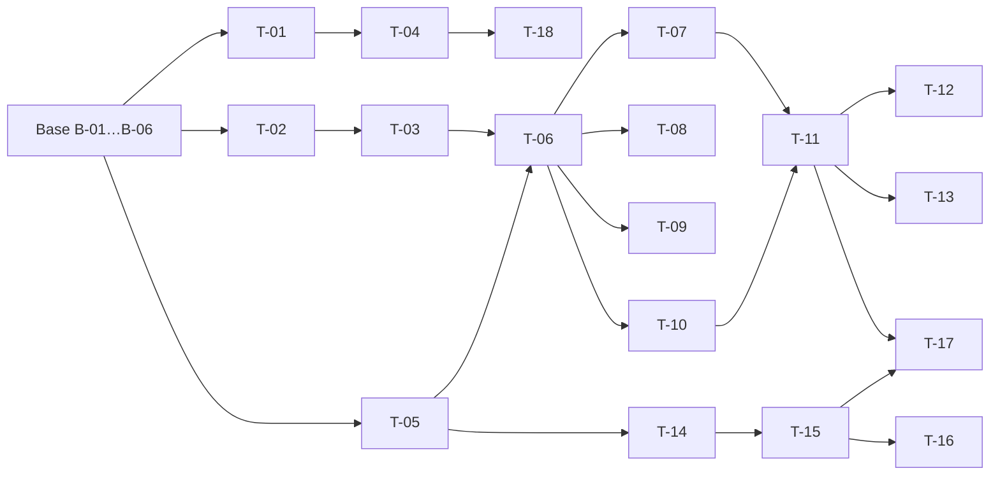

# Plan de implementación — tareas para el equipo

**Estado:** reparto APROBADO por el propietario (2026-11-25): la base la hacen el propietario y Claude Code; las funcionalidades, la alumna. Tarjetas sujetas a ajustes. **Fecha:** 2026-11-23.
**Para quién:** la desarrolladora que implementa las tareas y el propietario que las revisa.
**Fuentes:** `docs/ai/ROADMAP.md` (orden y criterios), `docs/VALIDACION-REQUISITOS.md` (reglas del cliente), `docs/DATA-MODEL.md` (tablas). Si este plan y esas fuentes no coinciden, mandan las fuentes; avisar al propietario.

## 1. Cómo se reparte el trabajo

| Bloque | Quién | Por qué |
|---|---|---|
| **Base** (B-01…B-06) | Propietario / Claude Code | Son las piezas de mayor riesgo (BD, seguridad, sesiones, CI) y sirven de modelo para todo lo demás |
| **Tareas** (T-01…T-18) | Alumna | Funcionalidades del sistema, una por vez, siguiendo el ejemplo de la base |
| **Cierre** (C-01…C-04) | Propietario | Rendimiento, seguridad, respaldos y despliegue |

La alumna empieza cuando B-01…B-05 estén en `main`. Cada tarea indica su tarea equivalente del roadmap (`TASK-xxx`).

## 2. Reglas para trabajar (leer antes de la primera tarea)

### Preparar el equipo

1. Instalar Node 24 (`nvm install 24` y `nvm use 24`), pnpm 12.18.0 y Docker Desktop (para PostgreSQL local).
2. Clonar el repositorio y ejecutar `pnpm install`.
3. Comprobar que todo pasa: `pnpm lint`, `pnpm typecheck`, `pnpm test`, `pnpm build`.
4. Leer `AGENTS.md`, `docs/GUIA-MOLDE-MODULO.md` (cómo copiar el molde), `docs/VALIDACION-REQUISITOS.md` §1 y la parte de `docs/DATA-MODEL.md` que toque la tarea.
5. Instalar el navegador de las pruebas E2E: `pnpm --filter @sistema-dental/web exec playwright install chromium`.

### Flujo de cada tarea

1. Crear una rama desde `main` actualizado: `git switch -c feat/T-03-intervalos`.
2. Trabajar en **vertical slice**: contrato en `packages/contracts` → migración → API → pantalla → pruebas.
3. Hacer commits pequeños con mensajes claros (`feat: ...`, `fix: ...`, `test: ...`).
4. Antes de pedir revisión: `pnpm lint`, `pnpm typecheck`, `pnpm test`, `pnpm build` en verde.
5. Abrir un Pull Request hacia `main` con la plantilla de la sección 6. **Nunca** hacer push directo a `main`.
6. El propietario revisa. Las tareas marcadas 🔒 requieren revisión más estricta antes de aceptar.

### Prohibido

- Datos reales de pacientes, fotos de fichas o archivos clínicos en el repositorio: **es público**. Usar datos inventados.
- Secretos, contraseñas o `.env` en commits (solo `.env.example` sin valores reales).
- Cambiar la base de datos sin migración (`synchronize` siempre `false`).
- Agregar funciones que el cliente no pidió (roles extra, pagos automáticos, IA, WhatsApp API, app móvil).
- Decir que algo funciona sin haberlo probado.

### Cuándo está terminada una tarea

- Cumple todos los criterios de aceptación de su tarjeta.
- Tiene pruebas: unitarias de la lógica, de API (supertest) y, si tiene pantalla, al menos una prueba E2E del recorrido principal.
- `lint`, `typecheck`, `test` y `build` en verde, también en la CI del Pull Request.
- Textos de pantalla en español; funciona en celular de 360 px de ancho.

## 3. Base (propietario / Claude Code)

| ID | Qué deja listo | Roadmap |
|---|---|---|
| B-01 | CI en GitHub Actions: `lint`, `typecheck`, `test`, `build` en cada Pull Request; `main` protegida. **Hecho:** workflow `.github/workflows/ci.yml`; protección de `main` pendiente | — |
| B-02 | PostgreSQL local con Docker Compose, TypeORM 0.3, migraciones, `.env.example`, pruebas de integración contra BD real. **Hecho** | TASK-003 |
| B-03 | Seguridad base: validación de variables de entorno, DTOs validados, errores genéricos, CORS, cookies seguras y CSRF. **Hecho** (cookies de sesión en B-04) | TASK-004 |
| B-04 | Login del dentista, sesiones, bloqueo por intentos, cierre por inactividad, y auditoría mínima. **Hecho** | TASK-101, TASK-102 |
| B-05 | **Tarea modelo:** catálogo de tratamientos completo (migración, API, pantalla, pruebas) para que la alumna copie el patrón. Incluye la base web: login del dentista, panel, cambio de contraseña, cliente de API y estilos. **Hecho**; guía en `docs/GUIA-MOLDE-MODULO.md` | TASK-201 (parte de tratamientos) |
| B-06 | Playwright configurado con E2E de login y de tratamientos, en escritorio y a 360 px, también en la CI. **Hecho** | TASK-605 (parte inicial) |

## 4. Tareas para la alumna

Tamaño: **S** pequeña, **M** mediana, **L** grande. 🔒 = lógica crítica (concurrencia, dinero o privacidad): revisión estricta.

### Etapa 1 — Configuración y horarios

**T-01 · Configuración de la clínica** · M · TASK-201 · depende de B-05 (copiar el molde `treatments`)
- Objetivo: el dentista configura precio de consulta (30 Bs), anticipo único, QR de pago y número de WhatsApp.
- Tabla: `clinic_settings` (una sola fila).
- Criterios: anticipo solo entre 10 y 20 Bs y no mayor que la consulta; cada cambio queda en auditoría; la imagen del QR **no** se guarda en Git.
- Pruebas: anticipo 9,99 y 20,01 Bs rechazados; cambio auditado.

**T-02 · Intervalos de atención** · M · TASK-202 · depende de B-04
- Objetivo: el dentista crea, edita y elimina horarios de atención por fecha (por ejemplo, 15/12 de 08:00 a 12:00).
- Tabla: `availability_interval`.
- Criterios: mínimo 45 min; dos intervalos del mismo día no se superponen; no se puede reducir un intervalo dejando fuera una cita confirmada.
- Pruebas: superposición rechazada; reducción con cita confirmada rechazada.

**T-03 · Cálculo de horarios disponibles** · L · 🔒 · TASK-203 · depende de T-02
- Objetivo: `GET` de horarios libres para una fecha, en franjas de 45 min.
- Criterios: no ofrece el día actual (mínimo el día siguiente, hora de La Paz); oculta franjas ocupadas por reservas vigentes, confirmadas, completadas o no asistidas; una reserva vencida libera su franja; la última franja cabe completa en el intervalo.
- Pruebas: casos borde de fin de intervalo, cambio de día y huso horario.

### Etapa 2 — Portal público y reserva

**T-04 · Portal público** · M · TASK-301 · depende de T-01
- Objetivo: adaptar el diseño de `docs/referencia/lumina-dental/` a Renovando Sonrisas: inicio, tratamientos activos y botón de WhatsApp.
- Criterios: sin textos, fotos ni datos de Lúmina; sin selección de profesional; responsive a 360 px.

**T-05 · Pacientes (panel del dentista)** · M · TASK-501 · depende de B-04
- Objetivo: alta, edición y búsqueda de pacientes por nombre o celular.
- Criterios: mismo nombre normalizado + mismo celular no se duplica; mismo celular con otro nombre crea otro paciente con un aviso; menor de edad exige celular del apoderado y lleva la etiqueta de menor.

**T-06 · Reserva pública con espera de 8 minutos** · L · 🔒 · TASK-302 · depende de T-03 y T-05
- Objetivo: el paciente elige tratamiento, fecha y horario; responde si ya está registrado; si no, completa sus datos (nombre, celular, correo y fecha de nacimiento, más el celular del apoderado si es menor).
- Criterios: crea la cita `por_pagar` y aparta la franja 8 min; si dos pacientes reservan la misma franja al mismo tiempo, solo uno lo logra; máximo 3 citas pendientes por paciente; correo obligatorio.
- Pruebas: prueba de concurrencia contra PostgreSQL real; límite de 3 pendientes.

**T-07 · Pago por QR y comprobante** · M · 🔒 · TASK-401 · depende de T-06
- Objetivo: tras reservar, el paciente ve el QR y el monto del anticipo, y escribe su número de comprobante.
- Criterios: la cita sigue `por_pagar`; comprobante repetido rechazado; comprobante después de los 8 min rechazado con un mensaje que indique escribir por WhatsApp; se muestra un contador de tiempo.

**T-08 · Vencimiento automático de reservas** · S · TASK-304 · depende de T-06
- Objetivo: tarea programada cada minuto que cancela las reservas sin comprobante pasados 8 min.
- Criterios: no toca las que tienen comprobante; ejecutarla dos veces seguidas no cambia el resultado.

**T-09 · Mis consultas** · M · 🔒 · TASK-303 · depende de T-06
- Objetivo: el paciente ve sus consultas con nombre y celular (el menor, con el celular del apoderado).
- Criterios: nunca muestra historia clínica ni datos de otros; 5 intentos fallidos en 10 min bloquean 15 min; mensajes de error genéricos.

### Etapa 3 — Agenda del dentista

**T-10 · Agenda** · M · TASK-403 · depende de T-06
- Objetivo: vista por día y por semana con filtros por estado y paciente, y detalle de cada cita (anticipo, comprobante).

**T-11 · Confirmar pago** · M · 🔒 · TASK-402 · depende de T-07 y T-10
- Objetivo: el dentista ve las citas con comprobante y las confirma.
- Criterios: no existe botón de rechazar; queda registrado quién confirmó y cuándo; dos confirmaciones en paralelo no generan error de datos.

**T-12 · Reprogramar y marcar «no asistió»** · M · 🔒 · TASK-404 · depende de T-11
- Criterios: mover solo a una franja libre y guardar el antes y después; `no_asistio` solo desde `confirmada` con hora ya pasada; estados terminales no se modifican.

**T-13 · Cancelar y avisar** · M · TASK-405 · depende de T-11
- Objetivo: el dentista cancela (por ejemplo, a pedido del paciente por WhatsApp) con motivo; el anticipo no se devuelve.
- Criterios: la franja se libera; si el paciente tiene correo, se envía un aviso con hasta 3 reintentos sin bloquear la cancelación; si no tiene, la pantalla recuerda avisarle por WhatsApp.

### Etapa 4 — Clínica

**T-14 · Ficha del paciente** · M · 🔒 · TASK-502 · depende de T-05
- Objetivo: datos de contacto, consultas e historial clínico en una sola pantalla.
- Criterios: solo el dentista accede; cada apertura queda auditada sin copiar el contenido clínico.

**T-15 · Historia clínica por versiones** · L · 🔒 · TASK-503 · depende de T-14
- Objetivo: anamnesis, índice y diagnóstico; cada cambio crea una versión nueva y las anteriores no se editan.
- Criterios: guardar sin cambios no crea versión; se pueden ver las versiones anteriores.

**T-16 · Odontograma (FDI y CPO-D)** · L · TASK-504 · depende de T-15 · **bloqueada** hasta recibir del cliente la lista de estados de pieza
- Criterios: solo piezas FDI válidas, incluida la dentición temporal; solo estados aprobados; se guarda con la versión clínica.

**T-17 · Cerrar consulta** · S · TASK-505 · depende de T-11 y T-15
- Criterios: solo una cita confirmada cuya hora ya pasó; diagnóstico y costo obligatorios; costo ≥ 0; después queda de solo lectura.

### Etapa 5 — Contacto

**T-18 · Chat por reglas y WhatsApp** · M · TASK-601 · depende de T-04
- Criterios: respuestas fijas (horarios, ubicación, tratamientos), mensaje de urgencia con WhatsApp, respuesta por defecto con WhatsApp; sin IA, sin diagnósticos y sin pedir datos personales.

## 5. Cierre (propietario)

| ID | Qué | Roadmap |
|---|---|---|
| C-01 | Medir rendimiento y responsividad contra los RNF aprobados | TASK-602 |
| C-02 | Revisión de seguridad y privacidad | TASK-603 |
| C-03 | Respaldos y prueba de restauración | TASK-604 |
| C-04 | E2E completo en varios navegadores y despliegue en el VPS | TASK-605, TASK-606 |

## 6. Plantilla del Pull Request

```markdown
## Tarea
T-xx · nombre (TASK-xxx)

## Qué hice
- ...

## Cómo probarlo
1. ...

## Validaciones
- [ ] pnpm lint
- [ ] pnpm typecheck
- [ ] pnpm test
- [ ] pnpm build
- [ ] E2E del recorrido (si tiene pantalla)
- [ ] Probado a 360 px (si tiene pantalla)

## Criterios de aceptación
- [ ] (copiar los de la tarjeta)

## Dudas o pendientes
- ...
```

## 7. Orden sugerido



Etapas 1 y 2 primero (son la base de todo); T-05 y T-14 pueden avanzar en paralelo si hace falta.
