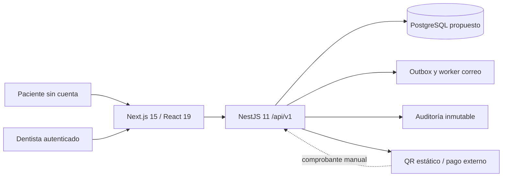
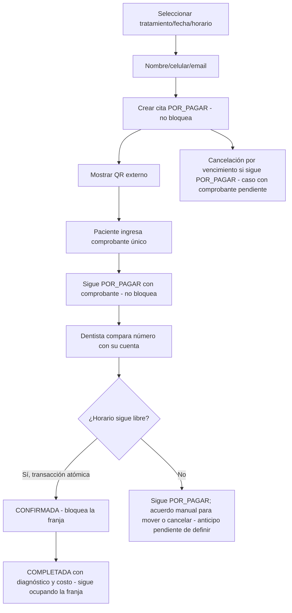

# PLAN — Sistema Dental Renovando Sonrisas

**Versión:** 0.1 (borrador). **Fecha:** 2026-11-20. **Aprobación:** pendiente.

## 1. Visión y fuentes

Construir un sistema web para un único dentista que centralice pacientes, agendamiento sin solapes, anticipo QR con verificación manual e historial clínico odontológico versionado. Portal público responsivo + panel privado. El Word `Doc_Dentista_v4.2.docx` es la fuente principal de reglas funcionales; `docs/BRIEF-SISTEMA-DENTAL.md` fija el stack/metodología, sujeto a decisiones. La demo Lúmina en `docs/referencia/` se aprovecha como identidad visual y experiencia de reserva, no como fuente de datos ni aplicación productiva.

**Estado de implementación observado:** no hay `apps/`, `packages/` ni producto ejecutable; solo brief, README y referencia Lúmina. HEAD de lectura: `8251eacee5068f0a559c1ce88e53b4006970b5a7`.

## 2. Alcance MVP (cada RF del documento está asignado)

| Área | Alcance MVP | RF | CU |
|---|---|---|---|
| Catálogo y configuración | Siete tratamientos iniciales; activar, desactivar, editar. Consulta 30 Bs; anticipo único 10–20 Bs y QR vigente configurados por el dentista; copia del anticipo al reservar | 01, 15 | 01, 07 |
| Horarios/disponibilidad | Intervalos por fecha, inicios cada 45 min, duración fija (90 o 45 min, pendiente), desde el día siguiente, protección contra solapes | 02, 14 | 01, 06, 10 |
| Agendamiento público | ¿Ya registrado? → datos existentes o registro con fecha de nacimiento (menor ⇒ celular de padre/madre); email obligatorio; máximo 3 pendientes; estado inicial `por_pagar` | 03–06 | 01 |
| Pago externo | Mostrar QR, registrar referencia única; dentista confirma, no rechaza | 07, 17, 18 | 02, 09 |
| Vista paciente | Consultar solo sus consultas y retomar pago; limitación de intentos | 08, 09 | 03 |
| Chat y contacto | Reglas fijas, urgencias, fallback y WhatsApp visible | 10–12, 28 | 04 |
| Autenticación | Usuario/clave dentista; bloqueo e inactividad | 13 | 05 |
| Agenda | Día/semana, filtros, detalle, mover y cancelar sin borrado físico; el paciente pide cancelar por WhatsApp; anticipo no se devuelve | 16, 19, 20 | 08, 10, 11 |
| Notificaciones | Correo de cancelación, reintentos hasta 3 | 21 | 11 |
| Pacientes | Alta/edición, deduplicación, búsqueda, ficha | 22, 23 | 12, 13 |
| Clínica | Historia versionada, odontograma, índice dental, diagnóstico y cierre de consulta | 24–26 | 14, 15 |
| Auditoría | Actor/fecha, versiones/valores previos y nuevos, solo inserción | 27 | 09–12 |

Las 28 RF entran en el objetivo del sistema; el orden de entrega por fases no implica postergar silenciosamente las RF de prioridad media. Se realizará entrega gradual de un MVP completo, con aceptación por módulos.

### Fuera del alcance actual

- Apps iOS/Android (React Native queda como opción futura, no como requisito v4.2).
- Varios odontólogos, recepcionistas, cuentas de paciente, multi-clínica.
- Pago/pasarela en línea, verificación bancaria automática, envíos por WhatsApp/SMS.
- Asistente con IA o diagnóstico clínico automático.
- Descuentos, certificados, facturación, inventario, reportes financieros complejos, recetas, consentimientos y adjuntos clínicos (salvo aprobación posterior).

## 3. Arquitectura lógica propuesta

- Monorepo: **pnpm + Turborepo**, Node 24, TypeScript strict.
- `apps/web`: rutas públicas (inicio, tratamientos, reservar, mis consultas, chat) y administrativas (`/admin/*`).
- `apps/api`: auth, patients, treatments, availability, appointments, payments, clinical-records, chat, notifications, audit, health.
- `packages/contracts`: DTOs/versiones y enums compartidos, sin exponer entidades TypeORM.
- TypeORM 0.3, **migraciones**; `synchronize: false` siempre.
- PostgreSQL es propuesta para permitir integridad transaccional robusta. Motor y PK se aceptarán mediante ADR.
- Login con sesión opaca revocable y Argon2, cookie `httpOnly`, CSRF, `sameSite`; CORS restringido y HTTPS.
- Cola/outbox de correo permite cancelar cita con éxito aun si el servicio SMTP está temporalmente caído.
- Datos clínicos solo en servidor; consultas públicas exponen DTOs mínimos y nunca devuelven historial/odontograma.
- Despliegue orientativo VPS Linux según brief; no desplegar sin autorización.

## 4. Procesos críticos

### 4.1 Agendamiento + anticipo

El **servidor** calcula disponibilidad de intervalos `[inicio, fin)` y vuelve a validar en la transacción de confirmación. No confiar en UI ni en un `SELECT` previo como única protección.

### 4.2 Historial clínico

Una ficha contiene `clinical_record` y versiones inmutables. Guardar una modificación crea `clinical_version` n+1 junto con los estados de las piezas; una versión anterior nunca se edita. Guardar sin cambios no añade versión. El cierre de consulta es un proceso separado: requiere diagnóstico y costo y puede ofrecer nueva versión clínica, pero no obligarla.

## 5. Pantallas / wireframes textuales

**Portal público:** `Inicio` (marca/hero), `Tratamientos`, `Agendar` (tratamiento → fecha y horario → identificación → resumen → QR/comprobante), `Mis consultas` (identificación y listado mínimo), `Chat y contacto` (FAQ reglada + WhatsApp visible).

**Panel privado:** `Iniciar sesión`, `Agenda` (día/semana, estados, filtros), `Pagos por confirmar` (consultas `por_pagar` con comprobante + confirmar), `Horarios` (intervalos por fecha), `Tratamientos` (catálogo), `Configuración` (precio de consulta, anticipo único y QR), `Pacientes` (buscador), `Ficha paciente` (contactos, consultas, última versión, versiones previas), `Odontograma` (pieza/estado), `Cerrar consulta` (diagnóstico y costo), `Auditoría` (según privilegios). En el MVP solo existe el dentista como usuario interno.

## 6. Reutilización de Lúmina (decisión por pieza)

> **Precedencia:** esta tabla **reemplaza** la sección «Qué se puede aprovechar en el sistema real» de `docs/referencia/lumina-dental/README.md`, escrita antes del Word v4.2. En particular, **no** aplican: tabla `appointment_request` confirmada por recepción, tabla de especialidades vinculada a odontólogos, motivos/duraciones de la demo como semilla, ni horarios `TIME_SLOTS`/`WEEK_HOURS`. La referencia no se modifica; esta nota es la fuente vigente.

| Pieza | Acción | Razón |
|---|---|---|
| Tokens CSS, Fraunces/Figtree, diseño editorial | **Adaptar** | Reemplazar marca y textos ficticios |
| Hero, tratamientos, layout responsivo | **Adaptar** | Preservar calidad visual, contenido real |
| Flujo de 4 pasos de cita | **Adaptar** | Quitar paso de preferencia profesional o sustituirlo por resumen; añadir pago QR y servidor |
| `AppointmentState` reducer | **Reutilizar lógica conceptual / refactorizar** | La versión actual nunca persiste y no valida email obligatorio |
| `isSlotTaken`, `TIME_SLOTS`, `WEEK_HOURS` | **Descartar como fuente de disponibilidad** | Días ocupados simulados; reglas reales en API |
| Catálogo y duraciones ficticias | **Descartar como semilla final** | V4.2 tiene siete tratamientos y duración uniforme |
| Gestión de foco, accesibilidad y pruebas E2E | **Reutilizar patrones / adaptar tests** | Recorridos deben validar backend real |
| Fotos de demo | **Sustituir al publicarse** | Confirmar derechos/identidad clínica |

Mapeo del estado visible: `reason` → `treatment_id` (tras selección válida de catálogo); `date/time` → `appointment.starts_at`; `form.name/phone/email` → paciente; `other/comment/firstVisit` son campos **no solicitados** en v4.2: eliminarlos o solicitar aprobación; `professional` **no aplica** (un solo dentista); `done` solo es estado local, **nunca** señal de reserva; el anticipo y su comprobante son pasos/entidades nuevos.

## 7. Estrategia de QA y Definition of Done

Por cada vertical slice: contratos tipados + migración + API + UI + test unitario + integración contra motor real + E2E Playwright de recorrido; lint, typecheck y build verdes antes de marcar `VERIFIED`. Probar estados inválidos, transacciones concurrentes, autorización negativa (IDOR), privacidad pública, navegadores y 360px. Ejecución no observada = `NOT EXECUTED`, no `PASS`.

RNF definidos: HTTPS/hashes, privacidad, integridad transaccional, huso/formatos y confidencialidad. Los límites numéricos de RNF propuestos quedan como metas sujetas a validación: no afirmar que el sistema los cumple sin medición.

## 8. Riesgos y dependencias

| Riesgo | Severidad | Mitigación |
|---|---|---|
| Paciente accede con nombre/celular sin prueba de posesión (riesgo aceptado por el cliente, ADR-003) | Alta | Rate limit RF-09, respuestas mínimas, sin datos clínicos |
| Doble confirmación de citas coincidentes | Crítica | Restricción/serialización en BD y test concurrente |
| Alteración/pérdida de historia clínica | Crítica | Versionado inmutable, auditoría, backups probados |
| Requerimientos odontológicos incompletos | Alta | Validación dentista de FDI, CPO-D y catálogo de estados |
| Datos en GitHub público (visibilidad pública ratificada por el propietario pese a que el cliente pidió espejo privado, ADR-008) | Alta | Nunca versionar datos clínicos reales, secretos ni el documento de requisitos; revisar cada STAGE; Forgejo canónico pendiente |
| Dependencia de QR/SMTP externo | Media | Flujo manual claro, outbox de correo |
| Migración de cuadernos (últimos 6 meses primero; resto gradual) | Alta | Piloto de digitalización + control de calidad + deduplicación; revisor pendiente |

## 9. Puertas de aprobación

1. Validación clínica y alcance del Word: respuestas del cliente registradas el 2026-11-20 (`VALIDACION-REQUISITOS.md` §6); quedan abiertas las de §7.
2. ADRs de motor BD, autenticación paciente, solapes y repositorios.
3. Modelo relacional/diagramas de datos aprobados.
4. Roadmap priorizado y Definition of Done acordado.
5. Permisos independientes para ejecutar cambios Git y despliegue.

No se ha generado código de aplicación en este paquete.
